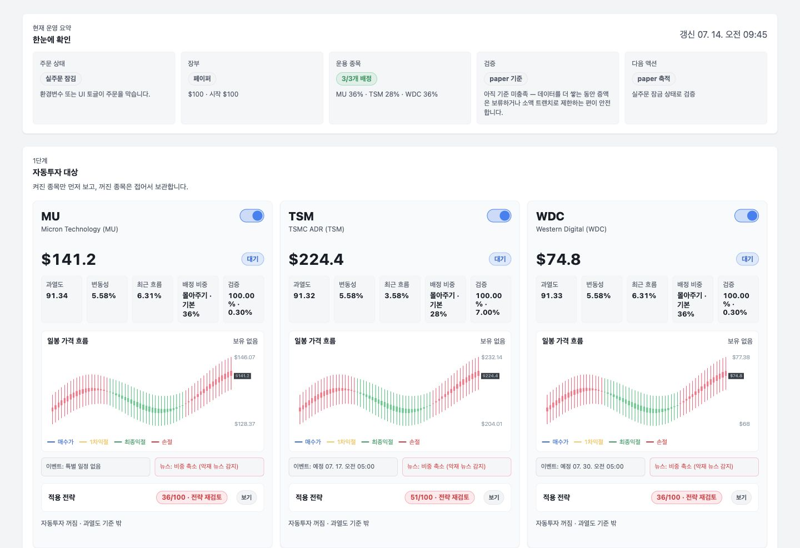
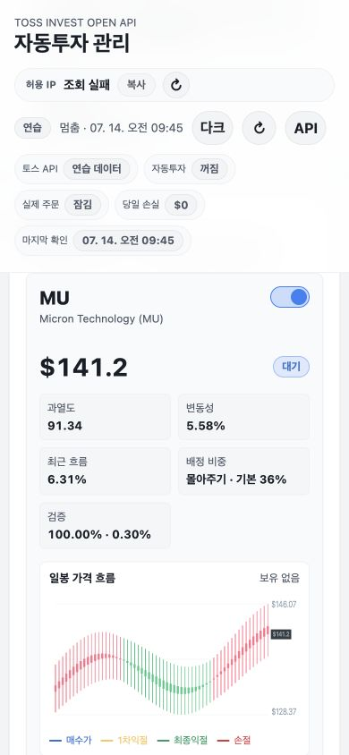
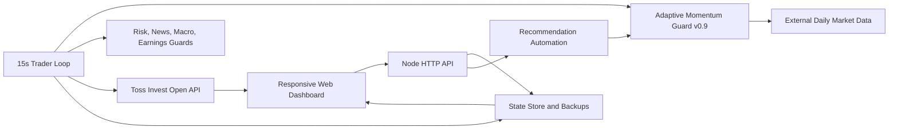

# Toss Invest Auto Terminal

토스증권 Open API를 이용해 미국 주식과 ETF의 조건 판단, 주문, 체결 동기화, 위험관리, 뉴스·거시 이벤트를 한 화면에서 관리하는 개인용 자동투자 대시보드입니다.

이 프로젝트의 핵심은 "매수 신호를 많이 만드는 봇"이 아니라, 실제 계좌에서 무엇이 왜 실행됐는지 설명하고 복구할 수 있는 운영 시스템을 만드는 것입니다. 기본 상태는 `dry-run`이며, 실제 주문에는 환경변수와 웹 토글의 이중 잠금이 적용됩니다.

> 이 저장소는 투자 수익이나 승률을 보장하지 않습니다. 백테스트 점수는 과거 데이터 기반 비교 지표이며 미래 성과 예측값이 아닙니다.

## 화면



<p align="center">
  
</p>

스크린샷은 실제 계좌가 아닌 모의 API와 `dry-run` 데이터로 촬영했습니다.

## 해결하려던 문제

- 토스증권 한 계좌 안에서 사용자가 직접 보유한 종목과 봇이 매매한 수량을 분리하고 싶었습니다.
- 소수점 주문, 정수 주문, 정규장, 장외 방어매도처럼 주문 조건이 달라지는 경우를 자동으로 처리해야 했습니다.
- 추천값과 백테스트 점수가 좋아 보여도 과적합, 수수료, 최대낙폭, 외부 데이터 실패를 구분할 수 있어야 했습니다.
- 컴퓨터나 네트워크가 끊겨도 설정, 체결 이력, 봇 장부가 사라지지 않아야 했습니다.
- 초보 사용자도 현재 주문 잠금, 운용 종목, 위험 상태, 다음 행동을 바로 이해할 수 있어야 했습니다.

고민과 해결 과정은 [프로젝트 케이스 스터디](docs/portfolio-case-study.md)에 정리했습니다.

## 주요 기능

| 영역 | 구현 내용 |
| --- | --- |
| 주문 안전 | `LIVE_TRADING=true`와 웹의 `실제 주문 허용`이 모두 켜져야 주문 실행 |
| 종목 관리 | 종목 추가·수정·삭제, 종목별 ON/OFF, 비중과 전략값 자동 저장 |
| 주문 방식 | 소수점 금액 주문과 정수 수량 주문 분리, 정규장·장외 방어매도 규칙 |
| 동적 배정 | 매수 조건을 통과한 종목끼리만 저장 비중을 다시 계산해 남은 예산 배정 |
| 봇 장부 | 수동 보유와 봇 보유 분리, 체결·부분체결 주기 동기화, 실현/미실현 손익 |
| 위험관리 | 종목 한도, 총 위험노출, 당일 손실, 급락, 손절, 부분익절, 트레일링 스탑 |
| 추천·검증 | 종목 정밀추천, 전체비중 추천, 안전설정 추천, alpha/guarded 이중 백테스트 |
| 시장 정보 | 종목 뉴스, 감성·티커 태그, 미국 경제 캘린더, 실적 발표 일정 자동 수집 |
| 운영 가시성 | Toss 연결 상태, 공인 IP, 요청 한도, 자동화 이력, 주문·안전장치 이벤트 |
| 학습 데이터 | 판단 샘플 사이드카, append-only 아카이브, 개선 리포트와 증액 게이트 |
| 반응형 UI | Toss Design System을 참고한 라이트/다크 테마, 모바일 1열 레이아웃 |

## 시스템 구조



외부 패키지 없이 Node.js 내장 HTTP 서버와 `fetch`를 사용합니다. 운영 의존성을 줄이고 작은 VM에서도 그대로 실행하기 위한 선택입니다.

## 전략과 검증

현재 엔진은 `Adaptive Momentum Guard v0.9 Dual-Backtest`입니다. 새 데이터 디렉터리의 기본 종목은 `MU`, `TSM`, `WDC`이며, 실제 운용 종목은 웹에서 자유롭게 바꿀 수 있습니다.

신규 매수는 종목별 이동평균 추세, 모멘텀, RSI, ATR, 선택적 ADX 조건을 함께 봅니다. 보유 후에는 추세 이탈, 손절, 1차 부분익절, 최종익절, 고점 대비 트레일링, RSI 과열, 당일 급락 방어를 평가합니다.

백테스트는 다음을 반영합니다.

- 학습 구간과 검증 구간 분리
- 매수·매도 비용 추정치 반영
- 수익률, 승률, 최대낙폭, Calmar 기반 위험조정 점수
- 안전장치 미포함 `alpha`와 실제 방어 로직 포함 `guarded` 결과 동시 표시
- 현재 설정보다 충분한 개선폭이 있을 때만 변경 추천
- 외부 데이터가 일시 실패하면 기존 비중을 유지하고 실패 원인을 표시

종목 정밀추천과 전체비중 추천의 백테스트는 Toss 시세 API 대신 외부 일봉과 캐시를 사용하므로 주문·계좌 API 요청 한도와 분리됩니다.

## 장부와 데이터

운영 데이터는 Git에 올라가지 않습니다.

```text
data/state.json                         # 설정, 포지션, 주문·자동화 상태
data/decision-samples.json              # 최근 판단 샘플 working set
data/decision-samples-archive.ndjson    # 전체 판단 샘플 append-only 아카이브
data/backups/                           # 10분 간격 rolling state 백업
```

긴 트레이더 틱과 웹 설정 저장이 겹쳐도 설정을 덮어쓰지 않도록 저장 작업을 직렬화하고, 트레이더와 UI가 소유하는 필드를 분리했습니다.

## 빠른 시작

요구 버전은 Node.js 22 이상입니다.

```bash
cp .env.example .env
node server.js
```

브라우저에서 [http://localhost:3000](http://localhost:3000)을 엽니다. 기본 설정은 실제 주문을 보내지 않습니다.

로컬 Node가 없다면 Codex 번들 Node를 사용할 수 있습니다.

```bash
/Users/joyanggi/.cache/codex-runtimes/codex-primary-runtime/dependencies/node/bin/node server.js
```

## 환경변수

```bash
PORT=3000
DATA_DIR=./data
LIVE_TRADING=false
DASHBOARD_PASSWORD=replace-with-long-random-password
TOSS_CLIENT_ID=
TOSS_CLIENT_SECRET=
TOSS_ACCOUNT_SEQ=
TOSS_BASE_URL=https://openapi.tossinvest.com
```

실제 키는 반드시 `.env` 또는 서버 전용 환경파일에만 저장합니다. `.env`와 `data/`는 `.gitignore`로 제외되어 있습니다.

## 실거래 전 확인

1. 토스 Open API 허용 IP에 봇이 실행되는 서버의 공인 IP를 등록합니다.
2. `LIVE_TRADING=false` 상태에서 연결·시세·보유·주문 동기화를 확인합니다.
3. 페이퍼 장부와 실제 장부가 섞이지 않았는지 확인합니다.
4. 웹의 `실제 주문 허용`을 켜기 전에 종목, 비중, 소수점, 장외 방어매도 설정을 다시 확인합니다.
5. 동일 계좌를 사용하는 봇 인스턴스는 하나만 실행합니다.

## 배포

Oracle Always Free VM용 `systemd` 서비스, 설치 스크립트, 백업 스크립트가 포함되어 있습니다.

- [Oracle VM 배포 가이드](deploy/oracle/README.md)
- [systemd 서비스](deploy/oracle/toss-invest.service)
- [상태 백업 스크립트](deploy/oracle/backup-state.sh)

공개 포트 노출보다는 Tailscale 또는 Cloudflare Access 같은 사설 접근 경로를 권장합니다.

## 코드 안내

| 경로 | 역할 |
| --- | --- |
| `server.js` | HTTP 서버, API 라우팅, 추천 캐시와 자동화 |
| `src/trader.js` | 모니터링 루프, 주문 계획, 체결 동기화, 봇 장부 |
| `src/strategy.js` | 신호 평가, 백테스트, 추천, 위험조정 점수 |
| `src/tossClient.js` | OAuth2, 계좌·시세·주문 API, rate limit 연동 |
| `src/store.js` | 영속 상태, 백업, 사이드카와 동시 저장 보호 |
| `src/calendar.js` | 경제지표 일정과 발표 결과의 거시 위험 판단 |
| `src/news.js` | 종목별 뉴스 수집, 감성·주제·티커 태깅 |
| `src/earnings.js` | 활성 종목의 실적 발표일 자동 수집 |
| `src/validation.js` | QQQ 벤치마크, MDD, 손익비, 증액 게이트 |
| `public/` | 반응형 대시보드 UI |
| `WORKLOG.md` | Codex·Claude 교차 검증 작업 기록 |

## 협업 방식

요구사항과 투자 판단은 사용자가 정의하고, Codex와 Claude가 구현과 교차 검증을 나누어 수행했습니다. 모든 기능 변경은 `WORKLOG.md`에 문제, 근거, 수정, 검증, 주의사항을 남기고 기능 단위로 커밋했습니다.

- [전체 작업 기록](WORKLOG.md)
- [레짐 로테이션 검토 문서](docs/regime-rotation-candidates.md)
- [이력서·포트폴리오용 케이스 스터디](docs/portfolio-case-study.md)
